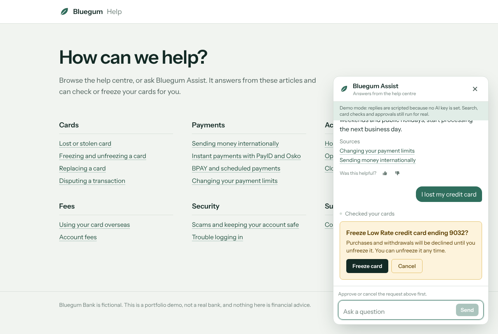
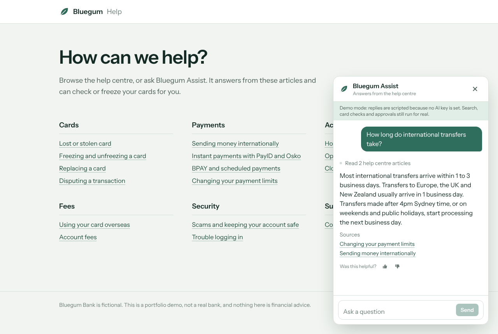
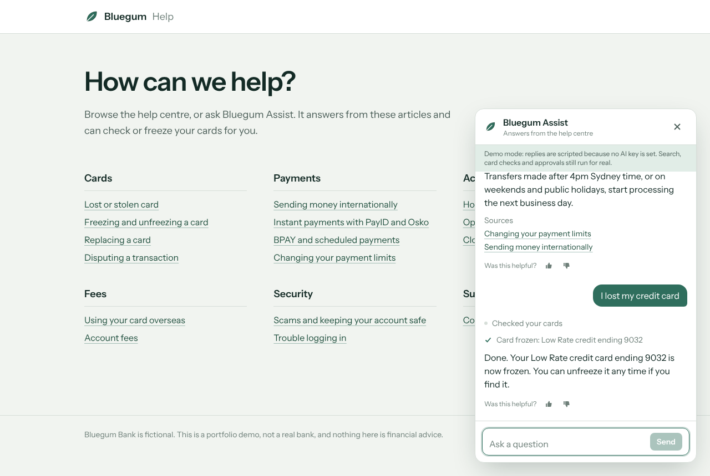
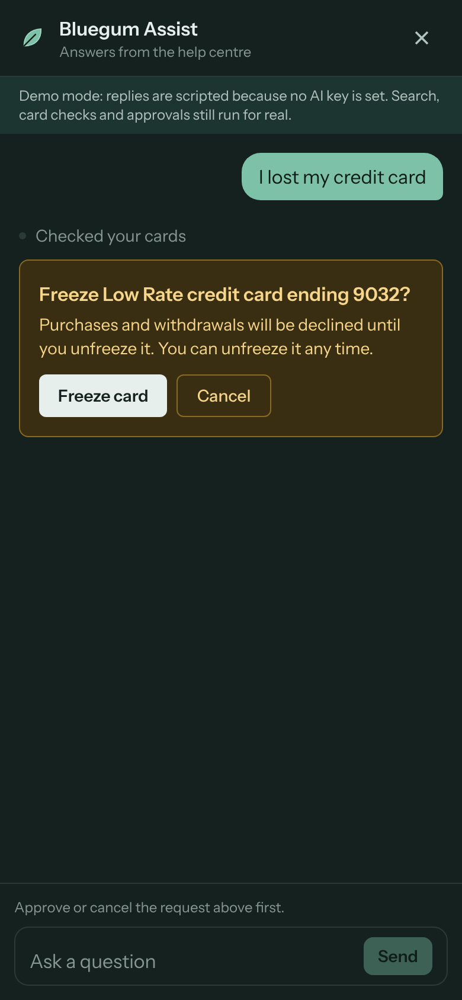

# Bluegum Assist

An AI support assistant for a fictional Australian bank. It answers questions from the bank's
help centre and cites the articles it used. It can also check the customer's cards and freeze or
unfreeze one, **but only after the customer approves that exact action**. An evaluation harness
measures retrieval and assistant behaviour, and the retrieval check gates CI.

It costs nothing to run: Groq's free tier for the model, Vercel's free tier for hosting. With no
API key at all it falls back to a scripted model, so tests, CI and a local demo never need the
network.

**Live demo:** _add your Vercel URL here_



> Bluegum Bank is fictional. Every product, fee and timeframe is invented for this demo.

## What it does

- **Answers from the help centre, with citations.** The assistant searches 16 help articles
  before answering and lists the articles it checked under each reply. That list comes from the
  search results, not the model's text, so the model can't invent a source.
- **Says when it doesn't know.** If no article covers a question, it says so and points to
  human support instead of answering from general knowledge.
- **Checks and freezes cards with human approval.** Freezing or unfreezing a card shows an
  approval card that names the exact card. The approval is HMAC-signed on the server, so a
  modified client can't forge one.
- **Stays in its lane.** No financial advice, no off-topic requests, and no following
  instructions hidden in messages. Length limits, a per-visitor daily cap and a global
  per-minute cap protect the free quota, and refused requests never reach the model.
- **A chat UI built for real use.** Streaming replies, a Stop button, visible tool progress,
  errors that say what to do next, feedback on answers, screen-reader announcements, keyboard
  support, phone layout and dark mode.

| Grounded answer                                      | After approval                  | Phone, dark mode                     |
| ---------------------------------------------------- | ------------------------------- | ------------------------------------ |
|  |  |  |

## How it was built: spec first, with OpenSpec

The behaviour was specified before any code was written, using
[OpenSpec](https://github.com/Fission-AI/OpenSpec) for spec-driven development:

```
openspec/
  changes/archive/…-add-support-assistant/
    proposal.md      why, what changes, which capabilities
    design.md        decisions with alternatives, risks and mitigations
    tasks.md         implementation checklist, each task with how it's verified
  specs/             the resulting specs, one per capability
    help-answers/  card-actions/  assistant-guardrails/  chat-widget/  assistant-evaluation/
```

Every requirement has WHEN/THEN scenarios, and each scenario maps to a test or an eval case.
Each eval case records which spec requirement it covers, so a failure points to the requirement
it broke.

## Architecture

```
Browser                         Server (Next.js route)
───────                         ──────────────────────
ChatWidget (useChat)  ──POST──▶ /api/chat
  ChatPanel (props only)          1. validate messages against tool schemas
  approval card                   2. length, daily and global limits  (refuse → 413 / 429)
  articles-checked list           3. createSupportAgent(customerId from cookie)
                                  4. stream ToolLoopAgent  ◀──▶  Groq or scripted model
                                         │
                                         ├─ searchHelpCentre ─▶ BM25 index (MiniSearch)
                                         ├─ getCardStatus    ─▶ CardStore
                                         └─ freeze/unfreeze  ─▶ approval policy ▶ CardStore
```

```
src/
  lib/assistant/   agent factory, instructions, tools, model selection, scripted demo model
  lib/help/        articles and search
  lib/cards/       card store (in memory, behind an interface)
  lib/limits.ts    fixed-window limiters
  lib/chat-handler.ts   the chat route's logic, with injected dependencies for testing
  components/chat/ widget (connection), panel (presentation), message parts, rich text
evals/             retrieval and assistant evals, cases and runners
```

## Decisions worth explaining

**One agent definition for the app and the evals.** `createSupportAgent()` builds the AI SDK
`ToolLoopAgent`. The chat route streams it and the eval harness calls `generate()` on the same
factory, so what's evaluated is exactly what ships.

**Safety lives in code, not the prompt.** The prompt asks the model to behave, but nothing
depends on it:

- Tools get the customer ID from the session, never from model input, so the model can't be
  talked into touching another customer's cards.
- Card changes need `user-approval`. The approval text is built on the server from the
  server's card data, and approvals are signed with `experimental_toolApprovalSecret`.
- A request for a card that isn't on the account is denied before the customer is ever asked.
- Message length and usage limits are checked before the agent is created.

**Keyword search, not embeddings (for now).** For 16 short articles, BM25 is fast, free,
deterministic and unit-testable. Groq has no embedding API, so embeddings would mean a second
provider. The retrieval eval is what would justify switching: if hit@3 drops as content grows,
move to hybrid search.

**Evals that can fail a build.**

- _Retrieval eval_ (36 labelled questions, no model needed): hit@1 87.9%, **hit@3 100%**,
  MRR 0.939, 0% false positives on uncovered questions. It runs inside Vitest, so CI fails if
  hit@3 drops below 90%. It has already caught two regressions during development: an ambiguous
  synonym ("charge" → "fee") and a brand-name stop word.
- _Assistant eval_ (14 cases): deterministic checks for tools called, approvals requested but
  not executed, articles cited, card state afterwards, and exact facts. Tone and refusals use
  the model as a judge at temperature 0, only for what code can't check. It exits non-zero
  below 85%.

**A scripted model instead of mocks everywhere.** `demo-model.ts` implements the AI SDK's
`LanguageModelV4` interface, routing on keywords and replying from real tool results. It drives
the real agent, tools and approval flow, which makes the 66 tests and the whole eval harness run
offline.

**Presentation separated from connection.** `ChatPanel` takes plain props, and only
`ChatWidget` knows about `useChat` and the network. The panel's tests render real message parts
(approval requested, auto-denied, sources) without mocking fetch.

## Running locally

Requires Node 20.19 or later.

```bash
npm install
cp .env.example .env.local      # add a free key from https://console.groq.com/keys
npm run dev                     # http://localhost:3000
```

Without `GROQ_API_KEY` the app runs in demo mode with scripted replies, and says so in the chat.

| Script                   | What it does                                                                 |
| ------------------------ | ---------------------------------------------------------------------------- |
| `npm run dev`            | Development server                                                           |
| `npm test`               | 66 tests, including the retrieval gate and eval harness                      |
| `npm run eval:retrieval` | Retrieval report: hit@1, hit@3, MRR, misses                                  |
| `npm run eval`           | Assistant eval against Groq (or the scripted model), writes `evals/results/` |
| `npm run check`          | Lint, type check and tests                                                   |

CI runs formatting, lint, type check, tests, the retrieval eval and a build on every push. The
live model eval runs on demand from the Actions tab, using a `GROQ_API_KEY` repository secret.

## Deploying to Vercel

Import the repo and set `GROQ_API_KEY` and `TOOL_APPROVAL_SECRET` (`openssl rand -base64 32`).
The app refuses to sign approvals in production without the secret.

## Known limits

- Card state and usage counters are held in memory per server instance. They reset on deploy
  and aren't shared across instances. Swap `CardStore` and `Limiter` for Postgres or Upstash
  Redis in production.
- No real authentication: each visitor gets their own demo customer via a cookie.
- Feedback is logged, not stored.

## What I'd do next

- Store feedback, and review not-helpful answers next to eval results each week
- Hybrid search once the help centre grows past what keyword search handles
- Playwright end-to-end tests in CI for the approval flow
- Conversation history that survives a page reload

## Licence

MIT
